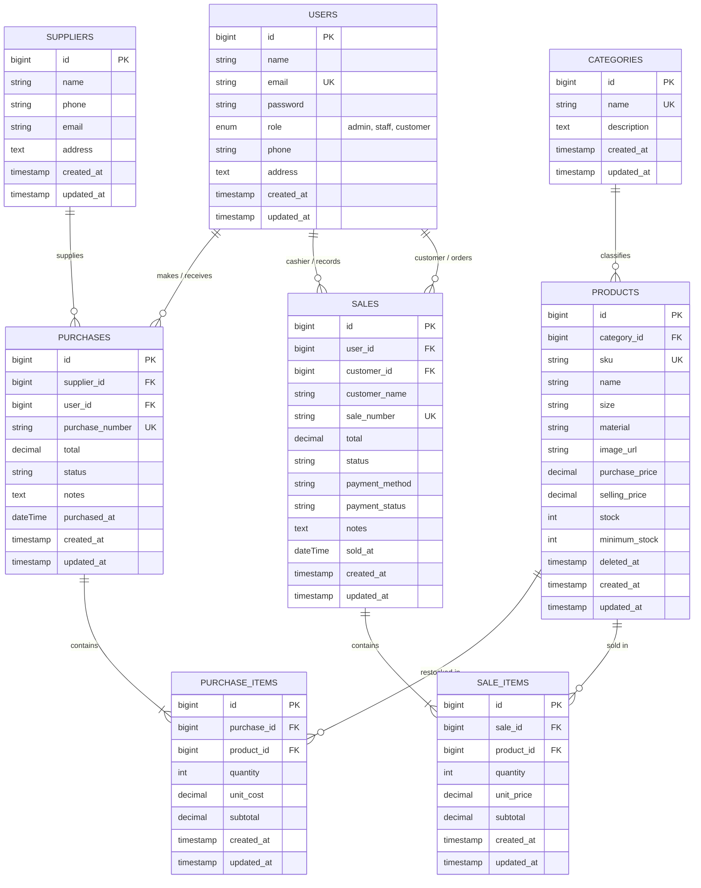

# HijabSociety - Integrated Hijab Inventory & Sales Management System

[](https://laravel.com)
[](https://php.net)
[](https://mysql.com)
[](https://tailwindcss.com)
[-success?style=for-the-badge&logo=checkmarx&logoColor=white)](#8-panduan-pengujian-otomatis-automated-testing-guide)

Aplikasi Web Terintegrasi untuk **Sistem Manajemen Inventaris & Transaksi Penjualan Toko Hijab "HijabSociety" (Modern, Chic & Syar'i Hijab Store)**, dibangun dengan tema **Soft Rose & Neutral Aesthetic yang elegan, modern, dan rapi** sebagai pemenuhan **Tugas Ujian Tengah Semester (UTS) Mata Kuliah Web Programming 2**.

---

## Daftar Isi
1. [Project Overview & Skenario Bisnis](#1-project-overview--skenario-bisnis)
2. [Spesifikasi & System Requirements](#2-spesifikasi--system-requirements)
3. [Panduan Instalasi & Setup Lingkungan (Reproducible)](#3-panduan-instalasi--setup-lingkungan-reproducible)
4. [Entity Relationship Diagram (ERD) & Penjelasan Relasi Database](#4-entity-relationship-diagram-erd--penjelasan-relasi-database)
5. [Matriks Hak Akses & Peran Pengguna (Role-Based Access Control)](#5-matriks-hak-akses--peran-pengguna-role-based-access-control)
6. [Daftar Akun Demo Pengujian & Sistem Login 3 Role](#6-daftar-akun-demo-pengujian--sistem-login-3-role)
7. [Fitur Unggulan & Aturan Bisnis yang Diimplementasikan](#7-fitur-unggulan--aturan-bisnis-yang-diimplementasikan)
8. [Panduan Pengujian Otomatis (Automated Testing Guide)](#8-panduan-pengujian-otomatis-automated-testing-guide)
9. [Known Limitations & Pengembangan Selanjutnya](#9-known-limitations--pengembangan-selanjutnya)

---

## 1. Project Overview & Skenario Bisnis

**HijabSociety** adalah sistem informasi manajemen inventaris dan kasir modern yang dirancang khusus untuk butik retail hijab muslimah dengan visualisasi **Soft Rose & Neutral Aesthetic** (warna Creamy White `#FFF9FB`, Soft Blush `#FDF2F8`, Rose Pink `#F43F5E`, Sage Green `#D1FAE5`, Warm Peach `#FFEDD5`, dan tipografi Quicksand & Plus Jakarta Sans).

Sistem ini mengintegrasikan seluruh alur operasional:
1. **Pengadaan Stok Bahan & Hijab (*Stock-In*)**: Pembelian multi-item dari produsen konveksi dan pabrik tekstil ke gudang toko.
2. **Manajemen Master Data Produk**: Klasifikasi hijab (Pashmina, Segi Empat, Bergo Instan, Khimar Syar'i, Inner & Aksesoris), penentuan harga modal vs jual, kontrol batas minimum stok, dan foto/ilustrasi produk.
3. **Penjualan Retail & Kasir (*Stock-Out*)**: Transaksi POS oleh kasir toko fisik maupun pemesanan mandiri oleh pelanggan terdaftar (*Customer Self-Service Order*).
4. **Pencegahan Overselling & Rekonsiliasi Realtime**: Penguncian baris produk (`lockForUpdate`) dalam transaksi atomik (`DB::transaction`) untuk memastikan keakuratan stok fisik.

### Masalah Bisnis yang Diselesaikan:
- **Ketidakkonsistenan Stok**: Meniadakan risiko selisih stok saat jam sibuk belanja dengan konkurensi locking di level basis data.
- **Pencegahan Data Korup (Multi-Item Atomicity)**: Jika pelanggan membeli 3 model hijab sekaligus dan salah satunya kehabisan stok, seluruh pesanan dibatalkan secara atomik (*rollback*), sehingga saldo kas dan stok tidak pernah gantung.
- **Transparansi Biaya & Keamanan Peran**: Memproteksi harga beli (*purchase price*) dari pelanggan, namun terbuka transparan bagi Admin & Staff Toko.
- **Monitoring Dini Kehabisan Stok**: Dasbor interaktif memberikan alert otomatis saat stok fisik berada di bawah batas minimum (*low stock alert*).
- **Pengalaman Pelanggan Bebas Hambatan (Passwordless Customer Login)**: Pelanggan cukup memasukkan Nama dan Email untuk masuk atau registrasi otomatis tanpa perlu mengingat kata sandi.
- **Dukungan Beragam Metode Pembayaran**: Mendukung QRIS Instant, Transfer Bank (BCA, Mandiri, BSI), E-Wallet, dan Tunai/Kasir.
- **Aset Ilustrasi Hijab Offline 100% Selalu Tampil**: Menyediakan 10 ilustrasi SVG lokal aesthetic di folder `public/images/hijab/` sehingga katalog dan struk faktur tetap tampil menawan tanpa koneksi internet luar.

---

## 2. Spesifikasi & System Requirements

Aplikasi ini dibangun menggunakan arsitektur modern Laravel 12 dengan dependensi berikut:
- **PHP**: Versi `^8.2` (dengan ekstensi `pdo_mysql`, `mbstring`, `openssl`, `tokenizer`, `xml`, `ctype`, `json`, `bcmath`).
- **Database Server**: MySQL `8.x` / MariaDB (bawaan XAMPP default port `3306`).
- **Dependency Manager**: Composer `2.x`.
- **Web Browser**: Google Chrome, Mozilla Firefox, Microsoft Edge, atau Safari versi terkini.
- **Framework**: Laravel `12.x`.
- **Frontend Assets**: Tailwind CSS, Font Awesome 6 Icons, Google Fonts (Quicksand & Plus Jakarta Sans).

---

## 3. Panduan Instalasi & Setup Lingkungan (Reproducible)

Ikuti langkah-langkah di bawah ini untuk menjalankan project dari nol di lingkungan XAMPP lokal:

### Langkah 1: Penempatan Folder Project
Pastikan folder project berada pada direktori:
```
C:\xampp\htdocs\integrated_laravel_project
```

### Langkah 2: Konfigurasi File Environment (`.env`)
Pastikan file `.env` telah mengonfigurasi koneksi MySQL XAMPP:
```env
APP_NAME="HijabSociety"
APP_ENV=local
APP_KEY=base64:wvbnMPoNRk0F0s7tCKvXO3QBBOBXhN/HP415WTK7kFY=
APP_DEBUG=true
APP_TIMEZONE=Asia/Jakarta
APP_URL=http://127.0.0.1:8000

DB_CONNECTION=mysql
DB_HOST=127.0.0.1
DB_PORT=3306
DB_DATABASE=integrated_laravel_project
DB_USERNAME=root
DB_PASSWORD=

SESSION_DRIVER=file
CACHE_STORE=file
```

### Langkah 3: Pembuatan Database MySQL
Pastikan modul MySQL di XAMPP Control Panel telah aktif (**Running**).
Buat database bernama `integrated_laravel_project` via phpMyAdmin atau terminal MySQL:
```sql
CREATE DATABASE IF NOT EXISTS integrated_laravel_project CHARACTER SET utf8mb4 COLLATE utf8mb4_unicode_ci;
```

### Langkah 4: Eksekusi Migration & Seeder Data Demo
Jalankan perintah Artisan untuk membuat 8 tabel relasional lengkap dan mengisinya dengan data awal:
```bash
php artisan migrate:fresh --seed
```
*Perintah di atas akan mengeksekusi 10 file migrasi serta mengisi akun 3 role (Admin, Staff, Customer), 5 kategori hijab, 4 supplier tekstil, 10 produk hijab realistis, 2 transaksi pembelian (Stock-In), dan 3 transaksi penjualan (Stock-Out).*

### Langkah 5: Menjalankan Server Lokal
Jalankan server development Laravel:
```bash
php artisan serve
```
Aplikasi dapat langsung diakses melalui browser pada alamat: **`http://127.0.0.1:8000`**

---

## 4. Entity Relationship Diagram (ERD) & Penjelasan Relasi Database

### Diagram ERD (Mermaid)



### Penjelasan Relasi Database:
1. **`hasMany()` vs `belongsTo()`**:
   - `Category::hasMany(Product::class)`: Satu kategori menaungi banyak produk hijab.
   - `Product::belongsTo(Category::class)`: Setiap produk hijab menyimpan `category_id` merujuk ke satu kategori.
   - `Purchase::hasMany(PurchaseItem::class)` dan `Sale::hasMany(SaleItem::class)`: Satu nota transaksi memuat banyak rincian barang.
2. **Foreign Key pada Tabel Detail (`purchase_items` & `sale_items`)**:
   - Menerapkan kaidah Normalisasi Database (1NF, 2NF, 3NF).
   - Memungkinkan transaksi multi-item tanpa batas baris produk.
   - Mengunci harga satuan historis (`unit_price`, `unit_cost`) saat transaksi terjadi, sehingga perubahan harga di masa mendatang tidak merusak laporan keuangan masa lalu.

---

## 5. Matriks Hak Akses & Peran Pengguna (Role-Based Access Control)

Aplikasi menerapkan sistem otorisasi berlapis menggunakan middleware server-side kustom (`RoleMiddleware`):

| Fitur / Modul Sistem | Route Endpoint | Admin (Owner) | Staff (Kasir/Gudang) | Customer (Pembeli) |
| :--- | :--- | :---: | :---: | :---: |
| **Login, Logout, & Register** | `/login`, `/logout`, `/register` | ✅ Akses | ✅ Akses | ✅ Akses (Bisa Daftar Baru) |
| **Dashboard Utama** | `GET /dashboard` | ✅ Full Metrik Omzet & Low-Stock | ✅ Metrik Operasional & Low-Stock | ✅ Ringkasan Belanja Mandiri |
| **Kategori Hijab (Lihat)** | `GET /categories` | ✅ Akses | ✅ Akses | ❌ 403 Forbidden |
| **Kategori Hijab (Tambah/Ubah/Hapus)** | `POST/PUT/DELETE /categories` | ✅ Hak Penuh | ❌ 403 Forbidden | ❌ 403 Forbidden |
| **Pemasok Tekstil (Lihat)** | `GET /suppliers` | ✅ Akses | ✅ Akses | ❌ 403 Forbidden |
| **Pemasok Tekstil (Mutasi)** | `POST/PUT/DELETE /suppliers` | ✅ Hak Penuh | ❌ 403 Forbidden | ❌ 403 Forbidden |
| **Master Produk Hijab (Lihat/Katalog)** | `GET /products`, `/catalog` | ✅ Tabel Master | ✅ Tabel Master | ✅ Katalog Belanja (Tanpa Harga Modal) |
| **Master Produk (Tambah/Ubah/Hapus)** | `POST/PUT/DELETE /products` | ✅ Hak Penuh (Soft Delete) | ❌ 403 Forbidden | ❌ 403 Forbidden |
| **Pengadaan Pembelian (Stock-In)** | `GET/POST /purchases`, `/create` | ✅ Akses | ✅ Akses | ❌ 403 Forbidden |
| **Batalkan Transaksi Pembelian** | `POST /purchases/{id}/cancel` | ✅ Hak Penuh | ❌ 403 Forbidden | ❌ 403 Forbidden |
| **Daftar Seluruh Penjualan Toko** | `GET /sales` | ✅ Semua Transaksi | ✅ Semua Transaksi | 🔒 Hanya Transaksi Miliknya Sendiri |
| **Buat Transaksi Penjualan (Kasir/Self)** | `GET/POST /sales`, `/create` | ✅ Kasir POS (Pilih Member/Guest) | ✅ Kasir POS (Pilih Member/Guest) | ✅ Order Mandiri (Otomatis Akun Sendiri) |
| **Detail Faktur / Nota Penjualan** | `GET /sales/{sale}` | ✅ Akses Seluruh Nota | ✅ Akses Seluruh Nota | 🔒 Nota Sendiri (Nota Orang Lain: 403) |
| **Batalkan Transaksi Penjualan** | `POST /sales/{sale}/cancel` | ✅ Hak Penuh (Stok Dikembalikan) | ❌ 403 Forbidden | ❌ 403 Forbidden |
| **Manajemen Pengguna & Hak Akses** | `GET/POST/PUT/DELETE /users` | ✅ CRUD Pengguna & Ubah Role | ❌ 403 Forbidden | ❌ 403 Forbidden |

---

## 6. Daftar Akun Demo Pengujian & Sistem Login 3 Role

Aplikasi menyediakan **Sistem Portal Login 3 Role** di route `/login`:

| Portal & Role | URL Halaman Login | Tema Visual | Kredensial Masuk | Skenario Pengujian |
|---|---|---|---|---|
| **Pelanggan (Customer)** | [`/login`](http://127.0.0.1:8000/login) | Soft Pink Pastel 🌸 | Cukup masukkan **Nama** & **Email** (`customer@hijabsociety.com` atau email baru tanpa password). | Belanja hijab di katalog, checkout mandiri, & pantau faktur belanja pribadi. |
| **Staff Kasir & Toko** | [`/staff/login`](http://127.0.0.1:8000/staff/login) | Soft Mint / Sage Green 🌿 | Email: `staff@hijabsociety.com`<br>Password: `password123` | Buat transaksi kasir butik (Stock-Out POS), catat restock pengadaan (Stock-In), & pantau stok menipis. |
| **Administrator & Owner** | [`/admin/login`](http://127.0.0.1:8000/admin/login) | Soft Lavender / Rose Gold 👑 | Email: `admin@hijabsociety.com`<br>Password: `password123` | Hak akses penuh: kelola produk, kategori, supplier, user management, pembatalan transaksi, & metrik omzet. |

---

## 7. Fitur Unggulan & Aturan Bisnis yang Diimplementasikan

1. **Atomic Concurrency Control (`DB::transaction` & `lockForUpdate`)**:
   Setiap transaksi penjualan dan pembelian dibungkus dalam blok atomik database untuk menjamin integritas data dan mencegah kondisi balapan (*race condition*).
2. **All-or-Nothing Rollback**:
   Jika terdapat salah satu item yang stok fisiknya tidak mencukupi, sistem secara otomatis menggugurkan seluruh transaksi dan mengembalikan respon kesalahan yang ramah pengguna.
3. **Pencatatan Otomatis Stock-In & Stock-Out**:
   - Pembelian (`purchases`) otomatis menambahkan stok produk (`increment`).
   - Penjualan (`sales`) otomatis memotong stok produk (`decrement`).
   - Pembatalan transaksi penjualan oleh Admin mengembalikan stok ke kondisi semula secara otomatis.
4. **Perlindungan Integritas Historis (Soft Deletes)**:
   Penghapusan produk hijab menggunakan soft delete sehingga nota penjualan dan pembelian masa lalu tetap valid dan dapat diaudit.

---

## 8. Panduan Pengujian Otomatis (Automated Testing Guide)

Aplikasi dilengkapi dengan suite pengujian otomatis komprehensif menggunakan PHPUnit dan Laravel Test Runner.

### Menjalankan Seluruh Automated Test
Jalankan perintah berikut di terminal:
```bash
php artisan test
```

### Hasil Eksekusi Test (100% Passing):
```
   PASS  Tests\Unit\ExampleTest
  ✓ that true is true                                                              0.01s

   PASS  Tests\Feature\AuthAndRoleTest (17 tests)
  ✓ login screen can be rendered                                                   0.34s
  ✓ staff and admin login screens can be rendered                                  0.03s
  ✓ register screen can be rendered                                                0.02s
  ✓ guest is redirected to login                                                   0.02s
  ✓ admin can access dashboard and admin routes                                    0.04s
  ✓ staff cannot access admin only route                                           0.02s
  ✓ customer cannot access admin or staff routes                                   0.02s
  ✓ customer can access dashboard                                                  0.02s
  ✓ user can login with valid credentials                                          0.03s
  ✓ user cannot login with invalid password                                        0.23s
  ✓ login with mismatched portal role is rejected                                  0.04s
  ✓ login with matching portal role succeeds                                       0.03s
  ✓ customer login requires name                                                   0.02s
  ✓ customer login with new name updates account and isolates orders               0.03s
  ✓ customer can login without password                                            0.03s
  ✓ staff and admin portals still require password                                 0.02s
  ✓ csrf token mismatch redirects back with friendly message                       0.02s

   PASS  Tests\Feature\DashboardTest (3 tests)
  ✓ admin dashboard displays aggregate metrics and low stock table                 0.04s
  ✓ staff dashboard displays operational metrics and low stock monitoring          0.03s
  ✓ customer dashboard displays order history and doll recommendations             0.03s

   PASS  Tests\Feature\ExampleTest (1 test)
  ✓ the application returns a successful response                                  0.02s

   PASS  Tests\Feature\MasterDataTest (9 tests)
  ✓ staff can view categories and suppliers but not create                         0.04s
  ✓ customer cannot view categories or suppliers or users                          0.02s
  ✓ admin can create category with validation                                      0.02s
  ✓ category cannot be deleted if has products                                     0.02s
  ✓ supplier cannot be deleted if has purchases                                    0.02s
  ✓ admin can create product with validation                                       0.02s
  ✓ admin can upload product photo                                                 0.03s
  ✓ product soft delete preserves transaction integrity                            0.03s
  ✓ admin cannot delete self in user management                                    0.02s

   PASS  Tests\Feature\PurchaseTest (7 tests)
  ✓ staff and admin can access purchases index and create                          0.04s
  ✓ customer cannot access purchases                                               0.03s
  ✓ store multi item purchase updates stock atomically                             0.03s
  ✓ staff cannot cancel purchase                                                   0.02s
  ✓ admin can cancel purchase and stock is deducted                                0.03s
  ✓ admin cannot cancel purchase if stock would become negative                    0.02s
  ✓ purchases create with product id preselects product for restock                0.02s

   PASS  Tests\Feature\SaleTest (8 tests)
  ✓ all roles can access sales index and create                                    0.04s
  ✓ customer can create self order and stock is decremented                        0.03s
  ✓ insufficient stock causes transaction rollback                                 0.03s
  ✓ customer cannot view other customers receipt                                   0.03s
  ✓ staff cannot cancel sale but admin can and stock is restored                   0.03s
  ✓ sale persists payment method and payment status                                0.03s
  ✓ customer sales index does not show new order button and syncs with dashboard   0.03s
  ✓ sales create with product id preselects product in cart                        0.02s

   PASS  Tests\Feature\UtsInventorySalesTest (7 tests)
  ✓ guest cannot access dashboard                                                  0.03s
  ✓ admin cannot create product with duplicate sku or negative price               0.03s
  ✓ purchase transaction increases product stock                                   0.03s
  ✓ sale transaction decreases product stock                                       0.03s
  ✓ sale with insufficient stock is rejected and stock unchanged                   0.02s
  ✓ sale atomicity rolls back all items if second item fails                       0.03s
  ✓ authorization prevents staff and customer from accessing admin routes          0.04s

  Tests:    53 passed (267 assertions)
  Duration: 2.20s
```

---

## 9. Known Limitations & Pengembangan Selanjutnya

1. **Payment Gateway Realtime**: Integrasi webhook otomatis dengan Midtrans / Xendit untuk status konfirmasi instan.
2. **Export Faktur PDF & Excel**: Penambahan tombol unduh invoice berformat PDF menggunakan `barryvdh/laravel-dompdf`.
3. **Penyimpanan Cloud Storage**: Konfigurasi driver AWS S3 / Google Cloud Storage untuk penyimpanan aset gambar produk skala besar.

---

### Identitas Pengembang
- **Nama Project**: HijabSociety - Integrated Inventory & Sales Management System
- **Tema Bisnis**: Butik Inventaris & Penjualan Hijab Modern & Syar'i
- **Mata Kuliah**: Web Programming 2 (Ujian Tengah Semester)
- **Tahun Akademik**: 2026
