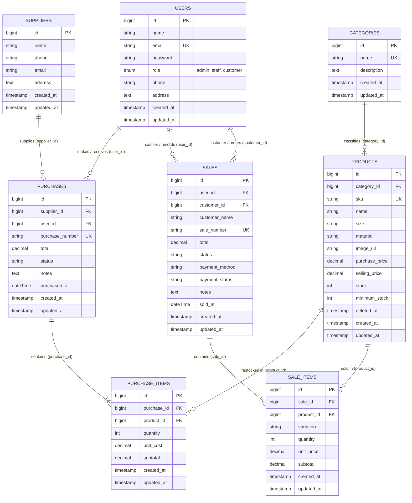

# HijabSociety - Integrated Hijab Inventory & Sales Management System

[](https://laravel.com)
[](https://php.net)
[](https://mysql.com)
[](https://tailwindcss.com)
[-success?style=for-the-badge&logo=checkmarx&logoColor=white)](#9-panduan-pengujian-otomatis-automated-testing-guide)

Aplikasi Web Terintegrasi untuk **Sistem Manajemen Inventaris & Transaksi Penjualan Toko Hijab "HijabSociety" (Modern, Chic & Syar'i Hijab Store)**, dibangun dengan tema visual **Soft Rose & Neutral Aesthetic yang elegan, bersih, dan modern** sebagai pemenuhan **Tugas Ujian Tengah Semester (UTS) Mata Kuliah Web Programming 2**.

---

## Daftar Isi
1. [Project Overview & Skenario Bisnis Toko Hijab](#1-project-overview--skenario-bisnis-toko-hijab)
2. [Spesifikasi & System Requirements](#2-spesifikasi--system-requirements)
3. [Langkah-Langkah Instalasi (Reproducible Setup Guide)](#3-langkah-langkah-instalasi-reproducible-setup-guide)
4. [Entity Relationship Diagram (ERD) & Penjelasan Relasi Database](#4-entity-relationship-diagram-erd--penjelasan-relasi-database)
5. [Matriks Hak Akses & Peran Pengguna (Role-Based Access Control)](#5-matriks-hak-akses--peran-pengguna-role-based-access-control)
6. [Daftar Akun Demo Pengujian & Sistem Login 3 Portal](#6-daftar-akun-demo-pengujian--sistem-login-3-portal)
7. [Dashboard Controller & Ringkasan Data Aktual](#7-dashboard-controller--ringkasan-data-aktual)
8. [Fitur Unggulan & Aturan Bisnis Terintegrasi](#8-fitur-unggulan--aturan-bisnis-terintegrasi)
9. [Panduan Pengujian Otomatis (Automated Testing Guide)](#9-panduan-pengujian-otomatis-automated-testing-guide)
10. [Audit Keamanan & Kesiapan Repositori GitHub](#10-audit-keamanan--kesiapan-repositori-github)

---

## 1. Project Overview & Skenario Bisnis Toko Hijab

**HijabSociety** adalah aplikasi web inventaris dan *Point of Sale* (POS) modern yang dirancang khusus untuk butik ritel dan distributor busana muslimah/hijab dengan sentuhan **Soft Rose & Neutral Aesthetic** (palet warna Creamy White `#FFF9FB`, Soft Blush `#FDF2F8`, Rose Pink `#F43F5E`, Sage Green `#D1FAE5`, Warm Peach `#FFEDD5`, dan tipografi elegan Google Fonts: Quicksand & Plus Jakarta Sans).

Sistem ini mengintegrasikan seluruh rantai operasional toko hijab:
1. **Pengadaan Stok Bahan & Hijab (*Stock-In*)**: Pembelian multi-item dari produsen konveksi dan pabrik tekstil ke gudang butik, yang secara otomatis menambah stok fisik produk (`increment`).
2. **Manajemen Master Data Terstruktur**:
   - **Kategori Hijab**: Pashmina Cantik, Segi Empat (Square), Bergo & Hijab Instan, Khimar & Syar'i Series, Inner & Aksesoris Hijab.
   - **Supplier Tekstil**: Rekanan pabrik tekstil dan konveksi hijab (PT Hijab Mandiri Tekstil Bandung, Galeri Konveksi Voal Utama Surabaya, dll.).
   - **Produk Hijab**: Pengelolaan SKU unik, ukuran hijab (175x75cm, 115x115cm, Size M, Jumbo), jenis bahan (Ceruty Babydoll Armani, Voal Ultrafine Tryspan, Silk Cradenza, Jersey Spandex, Wollpeach Silky), harga beli/modal, harga jual, stok aktual, batas minimum stok, dan unggah foto/ilustrasi.
   - **Pencegahan N+1 Query**: Seluruh pemanggilan relasi kategori dioptimalkan dengan Eager Loading (`with('category')`).
3. **Penjualan Retail & Kasir (*Stock-Out*)**:
   - Transaksi POS kasir toko fisik oleh Staff/Admin dengan dukungan pencarian pelanggan terdaftar atau mode Tamu/Umum (*Guest*).
   - Pemesanan mandiri oleh pelanggan terdaftar (*Customer Self-Service Order*) langsung dari katalog toko.
   - Pengurangan stok produk secara otomatis (`decrement`) saat transaksi berhasil disimpan.
4. **Keranjang Belanja (*Shopping Cart*) & Pilihan Variasi Hijab (Warna & Ukuran)**:
   - Pemilihan variasi warna dan ukuran langsung pada katalog produk sebelum dimasukkan ke keranjang belanja.
   - Halaman keranjang belanja (`/cart`) dengan kontrol kuantitas item, hapus item, pengosongan keranjang, dan rincian ringkasan biaya.
   - Checkout multi-item dengan pilihan metode pembayaran (QRIS, Transfer Bank, E-Wallet, Tunai/COD) dan penyimpanan variasi terpilih pada faktur nota penjualan.
5. **Pencegahan Overselling & Rekonsiliasi Realtime**:
   - Penguncian baris produk menggunakan `lockForUpdate()` di dalam transaksi atomik `DB::transaction`.
   - Mengambil harga jual langsung dari basis data server, bukan mempercayai input form peramban.
   - Validasi ketat ketersediaan stok fisik: jika ada satu item saja yang stoknya kurang, transaksi digugurkan seutuhnya (*All-or-Nothing Rollback*) tanpa meninggalkan data gantung.
6. **Aset Ilustrasi & Foto Hijab Nyata 100%**:
   - Menyediakan foto asli butik hijab lokal beresolusi tinggi di folder `public/images/hijab/` (pashmina ceruty, pashmina silk, pashmina rayon, segiempat voal, segiempat paris, segiempat motif, bergo hamidah, bergo sport, khimar french, inner ciput). Katalog dan nota tetap tampil sempurna tanpa dependensi internet eksternal.

---

## 2. Spesifikasi & System Requirements

Aplikasi dibangun menggunakan arsitektur modern Laravel 12 dengan kebutuhan lingkungan sebagai berikut:
- **PHP**: Versi `^8.2` (dengan ekstensi wajib: `pdo_mysql`, `mbstring`, `openssl`, `tokenizer`, `xml`, `ctype`, `json`, `bcmath`).
- **Database Server**: MySQL `8.x` / MariaDB (tersedia default pada paket XAMPP port `3306`).
- **Dependency Manager**: Composer `2.x`.
- **Framework**: Laravel `12.x`.
- **Web Browser**: Google Chrome, Mozilla Firefox, Microsoft Edge, Safari versi terkini.
- **Frontend Assets**: Tailwind CSS, Font Awesome 6 Icons, Google Fonts (Quicksand & Plus Jakarta Sans).

---

## 3. Langkah-Langkah Instalasi (Reproducible Setup Guide)

Berikut adalah panduan instalasi lengkap dan presisi untuk menjalankan project di komputer lokal/XAMPP dari awal:

### 1. Clone Repositori Git
Buka terminal (Git Bash, Command Prompt, atau PowerShell) dan jalankan:
```bash
git clone https://github.com/silmyarifah26-byte/integrated_laravel_project.git
cd integrated_laravel_project
```

### 2. Install Dependensi PHP
Jalankan Composer untuk mengunduh pustaka dan framework Laravel:
```bash
composer install
```

### 3. Salin File Konfigurasi Lingkungan (`.env`)
Salin file template `.env.example` menjadi `.env`:
- **Di Linux / macOS / Git Bash**:
  ```bash
  cp .env.example .env
  ```
- **Di Windows Command Prompt**:
  ```cmd
  copy .env.example .env
  ```
- **Di Windows PowerShell**:
  ```powershell
  Copy-Item .env.example .env
  ```

### 4. Konfigurasi Database pada `.env`
Buka file `.env` dan pastikan kredensial database sesuai dengan MySQL XAMPP Anda:
```env
APP_NAME="HijabSociety"
APP_ENV=local
APP_DEBUG=true
APP_TIMEZONE=Asia/Jakarta
APP_URL=http://127.0.0.1:8000

DB_CONNECTION=mysql
DB_HOST=127.0.0.1
DB_PORT=3306
DB_DATABASE=integrated_laravel_project
DB_USERNAME=root
DB_PASSWORD=
```

### 5. Buat Database MySQL
Pastikan modul **Apache** dan **MySQL** pada XAMPP Control Panel sudah dalam status **Running**.
Buat database bernama `integrated_laravel_project` melalui phpMyAdmin (`http://localhost/phpmyadmin`) atau jalankan query SQL:
```sql
CREATE DATABASE IF NOT EXISTS integrated_laravel_project CHARACTER SET utf8mb4 COLLATE utf8mb4_unicode_ci;
```

### 6. Generate Application Encryption Key
Jalankan perintah Artisan untuk membuat kunci enkripsi unik:
```bash
php artisan key:generate
```

### 7. Jalankan Migrasi Database & Seeding Data Awal
Eksekusi migrasi 8 tabel inti beserta pengisian data demo (akun 3 role, kategori hijab, pemasok tekstil, 10 produk hijab realistis, transaksi pembelian, dan transaksi penjualan):
```bash
php artisan migrate:fresh --seed
```

### 8. Jalankan Server Development Laravel
Nyalakan server lokal:
```bash
php artisan serve
```
Aplikasi kini siap diakses melalui peramban pada alamat:
👉 **`http://127.0.0.1:8000`**

---

## 4. Entity Relationship Diagram (ERD) & Penjelasan Relasi Database

### Diagram ERD (Mermaid)



### Penjelasan Relasi & Integritas Data Antar Tabel:
1. **Relasi `Category` ke `Product` (One-to-Many / `hasMany` & `belongsTo`)**:
   - Setiap produk hijab merujuk ke satu kategori melalui foreign key `category_id`.
   - Menggunakan relasi `RESTRICT` pada level bisnis: Kategori yang masih menaungi produk tidak dapat dihapus sembarangan untuk mencegah produk yatim (*orphan products*).
2. **Relasi `Supplier` ke `Purchase` (One-to-Many)**:
   - Satu supplier tekstil/konveksi dapat menyuplai banyak transaksi pembelian (`purchases`).
   - Supplier dengan riwayat pengadaan terkunci aman dari penghapusan fatal.
3. **Relasi Transaksi Header-Detail (`purchases` ➔ `purchase_items` & `sales` ➔ `sale_items`)**:
   - Memenuhi kaidah Normalisasi Database (1NF, 2NF, 3NF).
   - Memungkinkan nota pembelian atau penjualan menampung *n* item produk berbeda dalam satu transaksi atomik.
   - **Price Locking Historis**: Kolom `unit_cost` pada `purchase_items` dan `unit_price` pada `sale_items` menyimpan nilai riil saat transaksi dibuat. Perubahan harga jual atau modal di master produk masa depan tidak akan mengubah total pendapatan masa lalu.
4. **Relasi `User` ke Transaksi (`purchases` & `sales`)**:
   - `purchases.user_id`: Menyimpan identitas Staff/Admin yang bertanggung jawab melakukan input penerimaan stok dari supplier.
   - `sales.user_id`: Menyimpan kasir/petugas yang melayani transaksi.
   - `sales.customer_id`: Menyimpan ID akun pelanggan jika pembeli adalah anggota member terdaftar (nullable jika pembeli adalah tamu umum).
5. **Perlindungan Integritas Historis (`SoftDeletes`)**:
   - Tabel `products` menggunakan trait `SoftDeletes` (`deleted_at`).
   - Jika suatu produk dinonaktifkan/dihapus dari katalog, rekam jejak pada transaksi penjualan maupun pengadaan stok masa lalu tetap utuh dan laporan keuangan tetap akurat.

---

## 5. Matriks Hak Akses & Peran Pengguna (Role-Based Access Control)

Aplikasi menerapkan sistem otorisasi berlapis menggunakan middleware kustom (`RoleMiddleware`), Laravel Gates, dan Policies di sisi server:

| Fitur / Modul Sistem | Route Endpoint | Admin (Owner) | Staff (Kasir/Gudang) | Customer (Pelanggan) |
| :--- | :--- | :---: | :---: | :---: |
| **Login, Logout, & Register** | `/login`, `/logout`, `/register` | ✅ Akses | ✅ Akses | ✅ Akses (Bisa Daftar Baru) |
| **Dashboard Utama** | `GET /dashboard` | ✅ Full Metrik Omzet, PO, & Alert Stok Rendah | ✅ Metrik Operasional & Alert Stok Rendah | ✅ Riwayat Belanja Mandiri & Rekomendasi Hijab |
| **Kategori Hijab (Lihat)** | `GET /categories` | ✅ Akses | ✅ Akses | ❌ 403 Forbidden |
| **Kategori Hijab (Tambah/Ubah/Hapus)** | `POST/PUT/DELETE /categories` | ✅ Hak Penuh | ❌ 403 Forbidden | ❌ 403 Forbidden |
| **Pemasok Tekstil (Lihat)** | `GET /suppliers` | ✅ Akses | ✅ Akses | ❌ 403 Forbidden |
| **Pemasok Tekstil (Mutasi)** | `POST/PUT/DELETE /suppliers` | ✅ Hak Penuh | ❌ 403 Forbidden | ❌ 403 Forbidden |
| **Master Produk Hijab (Lihat/Katalog)** | `GET /products`, `/catalog` | ✅ Tabel Master | ✅ Tabel Master | ✅ Katalog Belanja (Tanpa Harga Modal) |
| **Keranjang Belanja & Variasi Produk** | `GET/POST /cart`, `/cart/add`, `/cart/checkout` | ✅ Akses | ✅ Akses | ✅ Akses Penuh (Pilih Variasi, Kelola Qty, Checkout) |
| **Master Produk (Tambah/Ubah/Hapus)** | `POST/PUT/DELETE /products` | ✅ Hak Penuh (Soft Delete) | ❌ 403 Forbidden | ❌ 403 Forbidden |
| **Pengadaan Pembelian (Stock-In)** | `GET/POST /purchases`, `/create` | ✅ Akses | ✅ Akses | ❌ 403 Forbidden |
| **Batalkan Transaksi Pembelian** | `POST /purchases/{id}/cancel` | ✅ Hak Penuh | ❌ 403 Forbidden | ❌ 403 Forbidden |
| **Daftar Seluruh Penjualan Toko** | `GET /sales` | ✅ Semua Transaksi | ✅ Semua Transaksi | 🔒 Hanya Transaksi Miliknya Sendiri |
| **Buat Transaksi Penjualan (Kasir/Self)** | `GET/POST /sales`, `/create` | ✅ Kasir POS (Pilih Member/Guest) | ✅ Kasir POS (Pilih Member/Guest) | ✅ Order Mandiri (Otomatis Akun Sendiri) |
| **Detail Faktur / Nota Penjualan** | `GET /sales/{sale}` | ✅ Akses Seluruh Nota | ✅ Akses Seluruh Nota | 🔒 Nota Sendiri (Nota Orang Lain: 403) |
| **Batalkan Transaksi Penjualan** | `POST /sales/{sale}/cancel` | ✅ Hak Penuh (Stok Dikembalikan) | ❌ 403 Forbidden | ❌ 403 Forbidden |
| **Manajemen Pengguna & Hak Akses** | `GET/POST/PUT/DELETE /users` | ✅ CRUD Pengguna & Ubah Role | ❌ 403 Forbidden | ❌ 403 Forbidden |

---

## 6. Daftar Akun Demo Pengujian & Sistem Login 3 Portal

Aplikasi mengimplementasikan antarmuka login 3 portal terpisah yang dirancang dengan warna dan fungsi spesifik di route `/login`:

| Portal & Role | URL Halaman Login | Tema Visual | Akun & Kredensial Demo | Skenario & Tugas Pengujian |
| :--- | :--- | :--- | :--- | :--- |
| **Pelanggan (Customer)** | [`/login`](http://127.0.0.1:8000/login) | Soft Pink Pastel 🌸 | **Email**: `customer@hijabsociety.com`<br>**Password**: `password123`<br>*(Tersedia juga akun: `zahra@hijabsociety.com`)*<br><br>💡 **Fitur Passwordless**: Pengunjung baru cukup mengetikkan **Nama** dan **Email** tanpa password untuk langsung login dan berbelanja! | - Buka katalog hijab retail.<br>- Lakukan checkout mandiri.<br>- Cek faktur nota pembelian.<br>- Pantau total belanjaan pribadi. |
| **Staff Kasir & Toko** | [`/staff/login`](http://127.0.0.1:8000/staff/login) | Sage Green & Mint 🌿 | **Email**: `staff@hijabsociety.com`<br>**Password**: `password123`<br>*(Staff Gudang / Cecep: `cecep.staff@hijabsociety.com`)* | - Catat transaksi kasir toko fisik (POS).<br>- Catat pengadaan stok supplier (Stock-In).<br>- Pantau daftar produk stok menipis (*low-stock*). |
| **Administrator & Owner** | [`/admin/login`](http://127.0.0.1:8000/admin/login) | Rose Gold & Purple 👑 | **Email**: `admin@hijabsociety.com`<br>**Password**: `password123` | - Akses seluruh ringkasan omzet & performa.<br>- Kelola Master Data Kategori, Supplier, & Produk.<br>- Kelola akun pengguna sistem (*User Management*).<br>- Batalkan transaksi yang keliru (*reversal stock*). |

---

## 7. Dashboard Controller & Ringkasan Data Aktual

Controller [`app/Http/Controllers/DashboardController.php`](app/Http/Controllers/DashboardController.php) secara dinamis menghitung dan menyajikan ringkasan data aktual dari database:

### Metrik untuk Administrator & Staff Kasir:
1. **Total Produk Aktif**: Menghitung jumlah produk hijab aktif yang tidak berstatus *soft-deleted* menggunakan query `Product::count()`.
2. **Total Transaksi Penjualan Hari Ini**:
   - Total nominal omzet hari ini: `Sale::where('status', 'completed')->whereDate('sold_at', Carbon::today())->sum('total')`.
   - Jumlah nota transaksi selesai hari ini: `Sale::where('status', 'completed')->whereDate('sold_at', Carbon::today())->count()`.
3. **Total Transaksi Penjualan Bulan Ini**:
   - Akumulasi nominal omzet bulan berjalan: `Sale::where('status', 'completed')->whereMonth('sold_at', Carbon::now()->month)->whereYear('sold_at', Carbon::now()->year)->sum('total')`.
   - Jumlah nota transaksi bulan berjalan: `count()`.
4. **Total Pengadaan Pembelian (Stock-In) Bulan Ini**:
   - Total modal pengadaan stok ke supplier: `Purchase::where('status', 'completed')->whereMonth('purchased_at', Carbon::now()->month)->sum('total')`.
5. **Jumlah Produk dengan Stok Rendah (Low-Stock Alert)**:
   - Menghitung produk yang sisa stok fisiknya berada pada atau di bawah batas minimum: `Product::whereColumn('stock', '<=', 'minimum_stock')->count()`.
   - Menampilkan tabel detail peringatan stok rendah lengkap dengan nama hijab, SKU, stok sisa, batas minimum, serta tombol aksi cepat **"Restock / Buat Purchase"** yang otomatis mengarahkan ke formulir pembelian dengan produk terkait telah terisi.
6. **5 Transaksi Terakhir**:
   - Menampilkan 5 transaksi penjualan terakhir dan 5 transaksi pembelian pengadaan terakhir dengan rincian nota, status, pembeli/supplier, dan total nominal.

### Metrik Khusus Pelanggan (Customer View):
- Menampilkan total pesanan selesai (`myOrdersCount`) dan total pengeluaran belanja pribadi (`myTotalSpent`).
- Menampilkan 5 riwayat pesanan hijab terbaru milik akun tersebut dengan rincian status lunas dan link faktur.
- Menampilkan katalog rekomendasi hijab aktif yang siap dipesan.
- Metrik internal bisnis (laba, supplier, pengadaan modal, alert gudang) disembunyikan secara ketat demi kerahasiaan data toko.

---

## 8. Fitur Unggulan & Aturan Bisnis Terintegrasi

1. **Atomic Concurrency Control (`DB::transaction` & `lockForUpdate`)**:
   Setiap transaksi penjualan kasir maupun pengadaan stok dibungkus dalam blok atomik database untuk menjamin integritas data dan mengeliminasi risiko *race condition* atau *double spending*.
2. **Strict Server-Side Price & Stock Verification**:
   Harga jual produk tidak pernah mempercayai input peramban pengguna; sistem selalu mengambil harga resmi langsung dari database saat eksekusi.
3. **Pencegahan Overselling (All-or-Nothing Rollback)**:
   Jika kuantitas barang yang dipesan melebihi sisa stok gudang, sistem secara otomatis menolak transaksi, menampilkan pesan galat yang informatif, dan membatalkan seluruh perubahan tanpa meninggalkan inkonsistensi data.
4. **Sinkronisasi Stok Otomatis**:
   - Transaksi Pembelian (`purchases`) otomatis menambah stok produk (`increment`).
   - Transaksi Penjualan (`sales`) otomatis memotong stok produk (`decrement`).
   - Pembatalan transaksi penjualan oleh Admin mengembalikan stok produk ke gudang secara otomatis (*restoration*).
5. **Pencegahan N+1 Query**:
   Semua relasi produk dan kategori pada katalog dan tabel master dioptimalkan dengan Eager Loading (`with('category')`).
6. **Penyimpanan Gambar Produk Otomatis via Database Seeder & Helper `asset()`**:
   Setiap produk hijab dilengkapi dengan gambar placeholder/dummy vektor estetik (SVG) sesuai kategori (Pashmina Ceruty, Silk, Rayon, Segi Empat Voal, Paris, Motif, Bergo Hamidah, Sport, Khimar French, dan Inner Ciput). Sistem secara otomatis mengalokasikan placeholder yang tepat saat seeding maupun saat pembuatan produk baru tanpa admin harus menginput manual satu per satu, dan seluruh Blade view merendernya secara otomatis menggunakan helper bawaan `asset($product->image_path)`.

---

## 9. Panduan Pengujian Otomatis (Automated Testing Guide)

Aplikasi memiliki rangkaian pengujian otomatis lengkap yang mencakup autentikasi multi-portal, pembagian hak akses (*authorization*), master data, mutasi produk, alokasi gambar placeholder estetik, transaksi pembelian (Stock-In), transaksi kasir penjualan (Stock-Out), dan kontrol konkurensi database.

### Menjalankan Automated Test
Jalankan perintah berikut pada terminal project:
```bash
php artisan test
```

### Hasil Verifikasi Pengujian (72 Passed, 411 Assertions - 100% Green):
```text
   PASS  Tests\Unit\ExampleTest
  ✓ that true is true                                                              0.01s

   PASS  Tests\Feature\AuthAndRoleTest (17 tests)
  ✓ login screen can be rendered                                                   0.34s
  ✓ staff and admin login screens can be rendered                                  0.03s
  ✓ register screen can be rendered                                                0.02s
  ✓ guest is redirected to login                                                   0.02s
  ✓ admin can access dashboard and admin routes                                    0.04s
  ✓ staff cannot access admin only route                                           0.02s
  ✓ customer cannot access admin or staff routes                                   0.02s
  ✓ customer can access dashboard                                                  0.03s
  ✓ user can login with valid credentials                                          0.04s
  ✓ user cannot login with invalid password                                        0.25s
  ✓ login with mismatched portal role is rejected                                  0.04s
  ✓ login with matching portal role succeeds                                       0.04s
  ✓ customer login requires name                                                   0.03s
  ✓ customer login with new name updates account and isolates orders               0.04s
  ✓ customer can login without password                                            0.03s
  ✓ staff and admin portals still require password                                 0.03s
  ✓ csrf token mismatch redirects back with friendly message                       0.03s
  ✓ gates differentiate roles and permissions                                     0.02s
  ✓ logout clears authenticated session                                           0.03s

   PASS  Tests\Feature\DashboardTest (3 tests)
  ✓ admin dashboard displays aggregate metrics and low stock table                 0.05s
  ✓ staff dashboard displays operational metrics and low stock monitoring          0.04s
  ✓ customer dashboard displays order history and doll recommendations             0.05s

   PASS  Tests\Feature\ExampleTest (1 test)
  ✓ the application returns a successful response                                  0.02s

   PASS  Tests\Feature\MasterDataTest (15 tests)
  ✓ staff can view categories and suppliers but not create                         0.04s
  ✓ customer cannot view categories or suppliers or users                          0.03s
  ✓ admin can create category with validation                                      0.03s
  ✓ category cannot be deleted if has products                                     0.03s
  ✓ supplier cannot be deleted if has purchases                                    0.03s
  ✓ admin can create product with validation                                       0.03s
  ✓ admin can upload product photo                                                 0.04s
  ✓ product soft delete preserves transaction integrity                            0.04s
  ✓ admin cannot delete self in user management                                    0.03s
  ✓ admin can update category with unique validation                               0.03s
  ✓ admin can delete category without products                                     0.03s
  ✓ admin can crud supplier successfully                                           0.05s
  ✓ admin can crud user in user management                                         0.04s
  ✓ admin cannot delete user with transaction history                             0.03s
  ✓ user management search and role filter                                         0.03s

   PASS  Tests\Feature\ProductModuleTest (8 tests)
  ✓ product index eager loads category preventing n plus one                       0.06s
  ✓ product index search by name and sku                                           0.05s
  ✓ product index filter by category                                               0.03s
  ✓ product index pagination                                                       0.05s
  ✓ product create strict server side validation                                   0.04s
  ✓ product update strict validation                                               0.04s
  ✓ customer role catalog view and mutation protection                             0.04s
  ✓ product automatically assigned aesthetic placeholder and renders via asset helper 0.04s

   PASS  Tests\Feature\PurchaseTest (8 tests)
  ✓ staff and admin can access purchases index and create                          0.05s
  ✓ customer cannot access purchases                                               0.03s
  ✓ store multi item purchase updates stock atomically                             0.04s
  ✓ purchase validation rules reject invalid payloads                              0.04s
  ✓ staff cannot cancel purchase                                                   0.03s
  ✓ admin can cancel purchase and stock is deducted                                0.04s
  ✓ admin cannot cancel purchase if stock would become negative                    0.03s
  ✓ purchases create with product id preselects product for restock                0.04s

   PASS  Tests\Feature\SaleTest (10 tests)
  ✓ all roles can access sales index and create                                    0.05s
  ✓ customer can create self order and stock is decremented                        0.04s
  ✓ insufficient stock causes transaction rollback                                 0.03s
  ✓ customer cannot view other customers receipt                                   0.05s
  ✓ staff cannot cancel sale but admin can and stock is restored                   0.04s
  ✓ sale persists payment method and payment status                                0.03s
  ✓ customer sales index does not show new order button and syncs with dashboard   0.04s
  ✓ sales create with product id preselects product in cart                        0.04s
  ✓ server enforces selling price from database ignoring browser input             0.03s
  ✓ reject sale when quantity is less than one                                     0.03s

   PASS  Tests\Feature\UtsInventorySalesTest (7 tests)
  ✓ guest cannot access dashboard                                                  0.03s
  ✓ admin cannot create product with duplicate sku or negative price               0.04s
  ✓ purchase transaction increases product stock                                   0.03s
  ✓ sale transaction decreases product stock                                       0.04s
  ✓ sale with insufficient stock is rejected and stock unchanged                   0.03s
  ✓ sale atomicity rolls back all items if second item fails                       0.03s
  ✓ authorization prevents staff and customer from accessing admin routes          0.06s

  Tests:    72 passed (411 assertions)
  Duration: 3.50s
```

---

## 10. Audit Keamanan & Kesiapan Repositori GitHub

Sebelum melakukan commit dan push ke GitHub publik/privat, seluruh aspek keamanan telah diaudit secara teliti:
- [x] **File Sensitif `.env` Terlindungi**: Terdaftar secara permanen pada `.gitignore` dan diverifikasi tidak pernah masuk ke *git index*.
- [x] **Template `.env.example` Bersih**: Tidak mengandung kredensial pribadi, API key, atau kata sandi database rahasia. Nilai `APP_KEY` dibiarkan kosong agar di-generate secara lokal oleh pengguna baru.
- [x] **Tidak Ada File Sementara / Scratch**: Repositori bebas dari file dump SQL, temporary log, maupun file tes usang.
- [x] **Struktur Folder Standar Laravel**: Seluruh kode controller, views blade, migration, seeder, dan asset ilustrasi berada pada direktori resmi Laravel 12.
- [x] **Branch Bersih & Siap Commit**: Siap untuk di-push ke GitHub secara aman.

---

### Informasi Proyek UTS
- **Nama Aplikasi**: HijabSociety - Integrated Inventory & Sales Management System
- **Tema Proyek**: Toko Retail & Grosir Hijab Muslimah Modern (Modern, Chic & Syar'i Hijab Store)
- **Mata Kuliah**: Web Programming 2
- **Tugas**: Ujian Tengah Semester (UTS)
- **Tahun**: 2026
